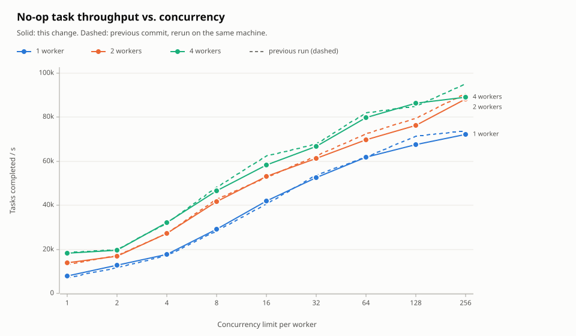
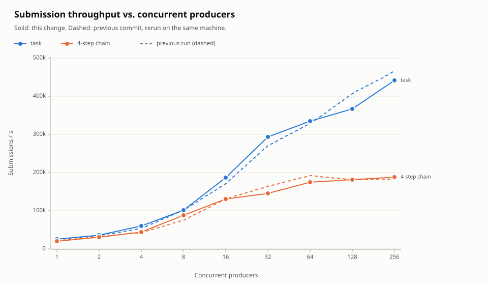
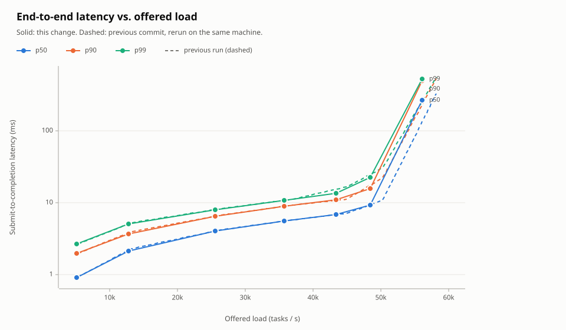
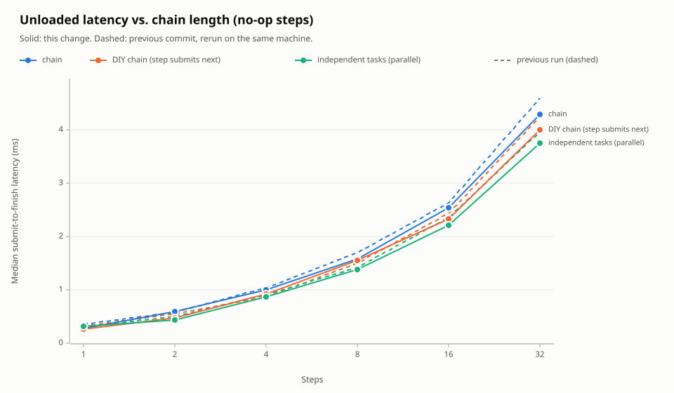
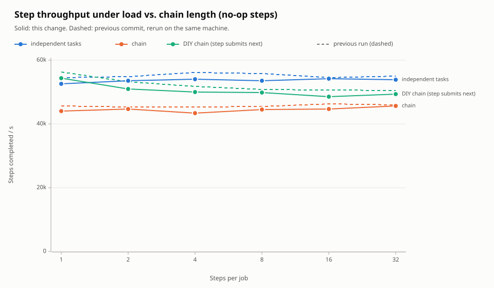
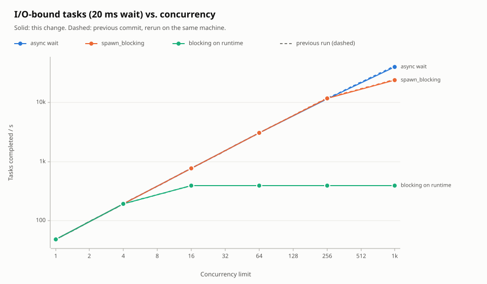
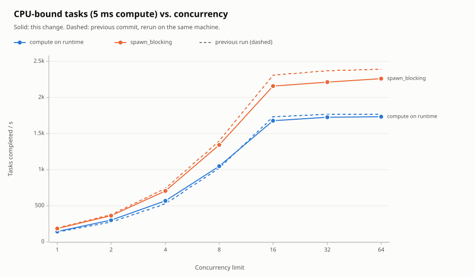
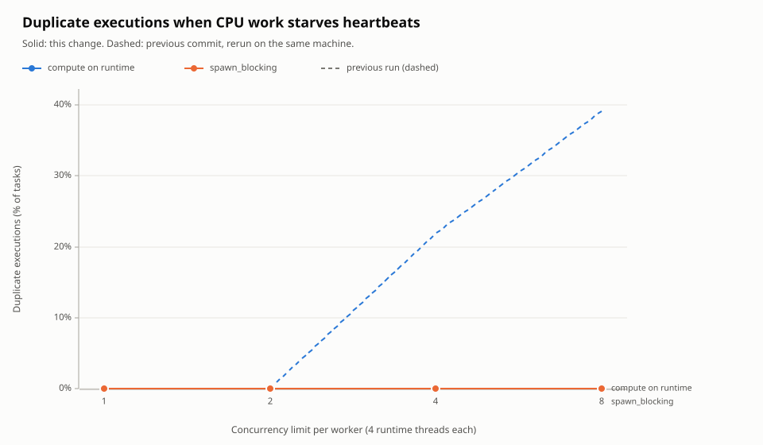

# Benchmark comparison

Generated by `cargo bench --bench load -- --compare <baseline> --noise <aa>`.

Positive changes are improvements, whichever direction the metric runs. A point is flagged only when its change exceeds the figure's threshold: the larger of 10% (5 percentage points for percentages) and twice the A/A noise between two runs of the baseline code.

| Figure | Median change | A/A noise | Threshold | Regressions | Improvements |
|---|---:|---:|---:|---:|---:|
| [No-op task throughput vs. concurrency](#consume_throughput) | -1.5% | 0.9% | 10.0% | 0 | 1 |
| [Submission throughput vs. concurrent producers](#submit_throughput) | +1.2% | 10.0% | 20.0% | 0 | 0 |
| [End-to-end latency vs. offered load](#latency_under_load) | +4.2% | 5.2% | 10.4% | 0 | 5 |
| [Unloaded latency vs. chain length (no-op steps)](#chain_latency) | +5.1% | 2.8% | 10.0% | 0 | 4 |
| [Step throughput under load vs. chain length (no-op steps)](#chain_throughput) | -3.3% | 1.1% | 10.0% | 0 | 0 |
| [I/O-bound tasks (20 ms wait) vs. concurrency](#io_bound) | -0.4% | 0.2% | 10.0% | 0 | 0 |
| [CPU-bound tasks (5 ms compute) vs. concurrency](#cpu_bound) | -3.1% | 3.4% | 10.0% | 0 | 0 |
| [Duplicate executions when CPU work starves heartbeats](#lease_starvation) | -0.0 pts | 0.0 pts | 5.0 pts | 0 | 2 |

## No-op task throughput vs. concurrency

| Series | Concurrency limit per worker | Before | After | Change (+ is better) | Verdict |
|---|---:|---:|---:|---:|---|
| 1 worker | 1 | 7.3k | 8.1k | +11.9% | improvement |
| 1 worker | 2 | 12k | 13k | +9.1% | within noise |
| 1 worker | 4 | 17k | 18k | +2.2% | within noise |
| 1 worker | 8 | 28k | 29k | +2.4% | within noise |
| 1 worker | 16 | 41k | 42k | +3.1% | within noise |
| 1 worker | 32 | 54k | 53k | -2.3% | within noise |
| 1 worker | 64 | 62k | 62k | +0.1% | within noise |
| 1 worker | 128 | 71k | 68k | -5.3% | within noise |
| 1 worker | 256 | 74k | 72k | -2.1% | within noise |
| 2 workers | 1 | 13k | 14k | +5.3% | within noise |
| 2 workers | 2 | 17k | 17k | -1.5% | within noise |
| 2 workers | 4 | 27k | 27k | -0.5% | within noise |
| 2 workers | 8 | 43k | 42k | -2.1% | within noise |
| 2 workers | 16 | 53k | 53k | +0.9% | within noise |
| 2 workers | 32 | 62k | 61k | -1.4% | within noise |
| 2 workers | 64 | 72k | 70k | -3.5% | within noise |
| 2 workers | 128 | 80k | 76k | -4.0% | within noise |
| 2 workers | 256 | 91k | 88k | -2.6% | within noise |
| 4 workers | 1 | 19k | 18k | -0.9% | within noise |
| 4 workers | 2 | 20k | 20k | -1.6% | within noise |
| 4 workers | 4 | 32k | 32k | +0.7% | within noise |
| 4 workers | 8 | 48k | 47k | -3.2% | within noise |
| 4 workers | 16 | 63k | 58k | -6.6% | within noise |
| 4 workers | 32 | 68k | 67k | -1.7% | within noise |
| 4 workers | 64 | 82k | 80k | -2.8% | within noise |
| 4 workers | 128 | 85k | 86k | +1.5% | within noise |
| 4 workers | 256 | 95k | 89k | -6.1% | within noise |

## Submission throughput vs. concurrent producers

| Series | Concurrent producers | Before | After | Change (+ is better) | Verdict |
|---|---:|---:|---:|---:|---|
| task | 1 | 26k | 26k | +0.5% | within noise |
| task | 2 | 35k | 37k | +6.7% | within noise |
| task | 4 | 54k | 60k | +11.2% | within noise |
| task | 8 | 101k | 103k | +1.2% | within noise |
| task | 16 | 171k | 187k | +9.2% | within noise |
| task | 32 | 271k | 294k | +8.2% | within noise |
| task | 64 | 329k | 336k | +2.0% | within noise |
| task | 128 | 407k | 367k | -9.9% | within noise |
| task | 256 | 465k | 442k | -5.0% | within noise |
| 4-step chain | 1 | 22k | 21k | -3.0% | within noise |
| 4-step chain | 2 | 33k | 32k | -3.4% | within noise |
| 4-step chain | 4 | 43k | 45k | +3.1% | within noise |
| 4-step chain | 8 | 75k | 89k | +18.1% | within noise |
| 4-step chain | 16 | 132k | 131k | -0.3% | within noise |
| 4-step chain | 32 | 165k | 146k | -11.6% | within noise |
| 4-step chain | 64 | 193k | 175k | -9.3% | within noise |
| 4-step chain | 128 | 182k | 182k | +0.1% | within noise |
| 4-step chain | 256 | 183k | 188k | +2.6% | within noise |

## End-to-end latency vs. offered load

| Series | Offered load (tasks / s) | Before | After | Change (+ is better) | Verdict |
|---|---:|---:|---:|---:|---|
| p50 | 5.1k | 0.92 | 0.90 | +2.3% | within noise |
| p50 | 13k | 2.27 | 2.10 | +7.4% | within noise |
| p50 | 26k | 4.14 | 3.99 | +3.7% | within noise |
| p50 | 36k | 5.71 | 5.51 | +3.4% | within noise |
| p50 | 43k | 7.03 | 6.75 | +3.9% | within noise |
| p50 | 48k | 10.7 | 9.25 | +13.1% | improvement |
| p50 | 56k | 324 | 267 | +17.6% | improvement |
| p90 | 5.1k | 1.96 | 1.95 | +0.5% | within noise |
| p90 | 13k | 3.93 | 3.62 | +7.8% | within noise |
| p90 | 26k | 6.69 | 6.49 | +3.0% | within noise |
| p90 | 36k | 9.20 | 8.88 | +3.5% | within noise |
| p90 | 43k | 11.1 | 10.8 | +2.2% | within noise |
| p90 | 48k | 22.1 | 15.7 | +28.8% | improvement |
| p90 | 56k | 534 | 498 | +6.6% | within noise |
| p99 | 5.1k | 2.66 | 2.67 | -0.1% | within noise |
| p99 | 13k | 5.22 | 5.00 | +4.2% | within noise |
| p99 | 26k | 8.25 | 7.90 | +4.2% | within noise |
| p99 | 36k | 11.1 | 10.7 | +3.3% | within noise |
| p99 | 43k | 16.6 | 13.5 | +18.8% | improvement |
| p99 | 48k | 30.5 | 22.5 | +26.1% | improvement |
| p99 | 56k | 557 | 525 | +5.7% | within noise |

## Unloaded latency vs. chain length (no-op steps)

| Series | Steps | Before | After | Change (+ is better) | Verdict |
|---|---:|---:|---:|---:|---|
| chain | 1 | 0.36 | 0.29 | +20.2% | improvement |
| chain | 2 | 0.59 | 0.59 | -0.7% | within noise |
| chain | 4 | 1.05 | 1.01 | +3.6% | within noise |
| chain | 8 | 1.70 | 1.59 | +6.8% | within noise |
| chain | 16 | 2.63 | 2.54 | +3.5% | within noise |
| chain | 32 | 4.58 | 4.29 | +6.4% | within noise |
| DIY chain (step submits next) | 1 | 0.32 | 0.26 | +16.9% | improvement |
| DIY chain (step submits next) | 2 | 0.55 | 0.47 | +14.5% | improvement |
| DIY chain (step submits next) | 4 | 0.88 | 0.93 | -5.5% | within noise |
| DIY chain (step submits next) | 8 | 1.50 | 1.56 | -3.9% | within noise |
| DIY chain (step submits next) | 16 | 2.44 | 2.33 | +4.6% | within noise |
| DIY chain (step submits next) | 32 | 4.24 | 4.00 | +5.7% | within noise |
| independent tasks (parallel) | 1 | 0.31 | 0.33 | -5.5% | within noise |
| independent tasks (parallel) | 2 | 0.50 | 0.44 | +12.5% | improvement |
| independent tasks (parallel) | 4 | 0.91 | 0.88 | +3.1% | within noise |
| independent tasks (parallel) | 8 | 1.42 | 1.39 | +2.7% | within noise |
| independent tasks (parallel) | 16 | 2.35 | 2.21 | +6.3% | within noise |
| independent tasks (parallel) | 32 | 3.95 | 3.75 | +5.1% | within noise |

## Step throughput under load vs. chain length (no-op steps)

| Series | Steps per job | Before | After | Change (+ is better) | Verdict |
|---|---:|---:|---:|---:|---|
| independent tasks | 1 | 54k | 53k | -3.4% | within noise |
| independent tasks | 2 | 55k | 54k | -2.4% | within noise |
| independent tasks | 4 | 56k | 54k | -3.5% | within noise |
| independent tasks | 8 | 56k | 53k | -4.1% | within noise |
| independent tasks | 16 | 55k | 54k | -0.6% | within noise |
| independent tasks | 32 | 55k | 54k | -2.3% | within noise |
| chain | 1 | 46k | 44k | -3.5% | within noise |
| chain | 2 | 45k | 45k | -1.5% | within noise |
| chain | 4 | 45k | 43k | -4.1% | within noise |
| chain | 8 | 46k | 44k | -2.3% | within noise |
| chain | 16 | 46k | 45k | -3.3% | within noise |
| chain | 32 | 46k | 46k | -0.7% | within noise |
| DIY chain (step submits next) | 1 | 56k | 54k | -3.4% | within noise |
| DIY chain (step submits next) | 2 | 53k | 51k | -4.2% | within noise |
| DIY chain (step submits next) | 4 | 52k | 50k | -3.5% | within noise |
| DIY chain (step submits next) | 8 | 51k | 50k | -1.8% | within noise |
| DIY chain (step submits next) | 16 | 51k | 49k | -4.2% | within noise |
| DIY chain (step submits next) | 32 | 50k | 49k | -2.1% | within noise |

## I/O-bound tasks (20 ms wait) vs. concurrency

| Series | Concurrency limit | Before | After | Change (+ is better) | Verdict |
|---|---:|---:|---:|---:|---|
| async wait | 1 | 48.3 | 48.3 | -0.1% | within noise |
| async wait | 4 | 192 | 192 | -0.0% | within noise |
| async wait | 16 | 772 | 770 | -0.2% | within noise |
| async wait | 64 | 3.1k | 3k | -0.5% | within noise |
| async wait | 256 | 12k | 12k | -0.2% | within noise |
| async wait | 1k | 42k | 40k | -4.8% | within noise |
| spawn_blocking | 1 | 48.2 | 48.1 | -0.1% | within noise |
| spawn_blocking | 4 | 192 | 192 | -0.4% | within noise |
| spawn_blocking | 16 | 772 | 771 | -0.1% | within noise |
| spawn_blocking | 64 | 3.1k | 3k | -0.3% | within noise |
| spawn_blocking | 256 | 12k | 12k | -2.0% | within noise |
| spawn_blocking | 1k | 25k | 24k | -3.1% | within noise |
| blocking on runtime | 1 | 48.2 | 48.1 | -0.4% | within noise |
| blocking on runtime | 4 | 193 | 192 | -0.4% | within noise |
| blocking on runtime | 16 | 390 | 389 | -0.4% | within noise |
| blocking on runtime | 64 | 391 | 390 | -0.4% | within noise |
| blocking on runtime | 256 | 391 | 389 | -0.4% | within noise |
| blocking on runtime | 1k | 391 | 390 | -0.4% | within noise |

## CPU-bound tasks (5 ms compute) vs. concurrency

| Series | Concurrency limit | Before | After | Change (+ is better) | Verdict |
|---|---:|---:|---:|---:|---|
| compute on runtime | 1 | 139 | 150 | +7.8% | within noise |
| compute on runtime | 2 | 275 | 301 | +9.7% | within noise |
| compute on runtime | 4 | 533 | 572 | +7.2% | within noise |
| compute on runtime | 8 | 1k | 1k | +2.7% | within noise |
| compute on runtime | 16 | 1.7k | 1.7k | -3.1% | within noise |
| compute on runtime | 32 | 1.8k | 1.7k | -2.4% | within noise |
| compute on runtime | 64 | 1.8k | 1.7k | -2.2% | within noise |
| spawn_blocking | 1 | 196 | 189 | -3.6% | within noise |
| spawn_blocking | 2 | 382 | 368 | -3.5% | within noise |
| spawn_blocking | 4 | 739 | 711 | -3.9% | within noise |
| spawn_blocking | 8 | 1.4k | 1.3k | -3.8% | within noise |
| spawn_blocking | 16 | 2.3k | 2.2k | -6.5% | within noise |
| spawn_blocking | 32 | 2.4k | 2.2k | -6.7% | within noise |
| spawn_blocking | 64 | 2.4k | 2.3k | -5.3% | within noise |

## Duplicate executions when CPU work starves heartbeats

| Series | Concurrency limit per worker (4 runtime threads each) | Before | After | Change (+ is better) | Verdict |
|---|---:|---:|---:|---:|---|
| compute on runtime | 1 | 0% | 0% | -0.0 pts | within noise |
| compute on runtime | 2 | 0% | 0% | -0.0 pts | within noise |
| compute on runtime | 4 | 22% | 0% | +21.9 pts | improvement |
| compute on runtime | 8 | 39% | 0% | +39.1 pts | improvement |
| spawn_blocking | 1 | 0% | 0% | -0.0 pts | within noise |
| spawn_blocking | 2 | 0% | 0% | -0.0 pts | within noise |
| spawn_blocking | 4 | 0% | 0% | -0.0 pts | within noise |
| spawn_blocking | 8 | 0% | 0% | -0.0 pts | within noise |
