# Performance characteristics

This document describes how `redis-task-graph` performs. It covers what regular tasks cost, what chains cost on top of that, and how throughput scales for tasks dominated by I/O waits or by CPU work. Every number and graph comes from the load-test suite in [`benches/load`](benches/load). The raw numbers are in [`perf/results/summary.md`](perf/results/summary.md), and you can reproduce them with:

```sh
cargo bench --bench load                    # all scenarios (~13 min), then renders graphs
cargo bench --bench load -- chain_latency   # one scenario
cargo bench --bench load -- --quick         # reduced smoke run
cargo bench --bench load -- --plot          # re-render graphs from saved results
```

## Key findings

- **A single worker completes about 7,400 no-op tasks/s when it processes one at a time, and about 75,000/s at concurrency 256.** Raising concurrency lets the worker overlap Redis round trips. Beyond roughly 64 in-flight tasks, Redis itself becomes the limit.
- **Latency stays low until load nears capacity.** At up to 85% of drain capacity, p99 latency from submit to completion stays under 15 ms. Past that point the backlog grows: latency is about 9× higher at 95% of capacity and 60× higher at 110%.
- **Chains cost about 18% of throughput when steps do no work and Redis is the bottleneck** (47k steps/s against 57k). They cost nothing measurable when steps wait on I/O and concurrency is the limit (21k against 21k). Chain length itself costs nothing.
- **Chains add latency because steps run one after another, not because of overhead.** Each chain step took 5.6 ms, the same as a standalone task (5.66 ms). A chain of 32 steps that each wait 5 ms takes 180 ms. The same 32 steps as independent tasks finish in 8 ms.
- **Large contexts hurt chains more than tasks.** Each hop sends its output back into Redis, so from 64 KB up a chain moves its payload at a 2–4× lower rate than plain tasks.
- **I/O-bound throughput is the concurrency limit divided by the wait time (Little's law),** up to the Redis ceiling. That holds only if the wait is truly async. A blocking call on the async runtime caps throughput at runtime threads ÷ wait: 391 tasks/s here, however high the concurrency.
- **CPU-bound work belongs in `spawn_blocking`.** Running compute directly on the runtime was 19–25% slower at every concurrency level. Before lease renewal moved off the async runtime, it also starved heartbeats, and **up to 39% of tasks ran twice**.
- **Pushback and a dedicated lease thread fixed the starvation at no throughput cost** (section 5). Duplicate executions dropped to **0%**. Under runtime-blocking load, p99 scheduling lag fell from **390 ms to 64 ms**. An interleaved A/B against the previous commit found **no regressions** in any scenario.

## Test environment and method

| | |
|---|---|
| Machine | Intel i7-11800H (8 cores / 16 threads), 32 GB RAM, Windows 11 |
| Redis | Memurai Developer 4.1.2 (Redis 7.2.5 compatible), localhost |
| Build | `cargo bench` (release profile), Tokio multi-threaded runtimes |

**Methodology**
- **Simulated machines:** each worker runs in its own Tokio runtime with a fixed number of threads, standing in for a separate machine.
- **Drain throughput:** for each throughput point, the queue is filled first, then the workers start. Throughput = processor executions ÷ (time from worker start to last execution).
- **Latency:** each job carries its submission timestamp, and the processor that finishes it records the elapsed time.
- **Repeats:** key comparisons take the median of 3 runs. Run-to-run variation was about ±10%.
- **Simulated I/O:** "I/O" is a dedicated device thread that completes each request after exactly its latency; a 20 ms wait measured 20.3 ms. `tokio::time::sleep` wasn't used because Windows timer ticks round a 20 ms sleep up to about 31 ms.
- **CPU work:** a xorshift loop calibrated to the target duration.

**Numbers vs. charts.** Sections 1–4 quote the original run (commit `9bc6867`). The charts and [`perf/results`](perf/results/summary.md) come from the latest run of the current code. This machine's speed drifted by up to 30–45% between sessions (section 5), so absolute values in the charts can differ from the text. The interleaved comparison in section 5 confirms the code itself didn't regress.

**Caveats.** Producers, workers and Redis all share one laptop, so absolute numbers are lower than on dedicated hardware. Treat the *shapes* and *ratios* as the findings. Loopback round trips are about 30 µs. On a real network (0.1–1 ms), single-connection throughput falls proportionally, which makes concurrency and batching matter even more.

## What each operation costs in Redis

All throughput limits come back to how much work each task does inside Redis. Redis runs commands on a single thread.

| Operation | Redis work |
|---|---|
| `submit` | 1 `XADD` |
| `chain(..).submit()` | `MULTI` · `HSET` (status) · `XADD` · `EXEC` |
| Claim | 1 `XREADGROUP`, amortized over up to `batch_size` tasks |
| Task success | 1 script: `XPENDING` (ownership check), `XACK`, `XDEL` |
| Chain step success | 1 script: `XPENDING`, `XACK`, `XDEL`, `XADD` (next step, carrying the output), `HSET` (progress) |
| Chain final step | 1 script: `XPENDING`, `XACK`, `XDEL`, `HSET` (output), `EXPIRE` |
| Failure | 1 script: ownership check, ack, then a `ZADD` (retry) or an `XADD` to the dead-letter stream |
| Heartbeat (long tasks only) | 1 script every lease ÷ 3: `XPENDING`, `XCLAIM` |

## 1. Baseline: regular tasks

### Throughput vs. concurrency

<picture>
  <source media="(prefers-color-scheme: dark)" srcset="perf/graphs/consume_throughput-dark.svg">
  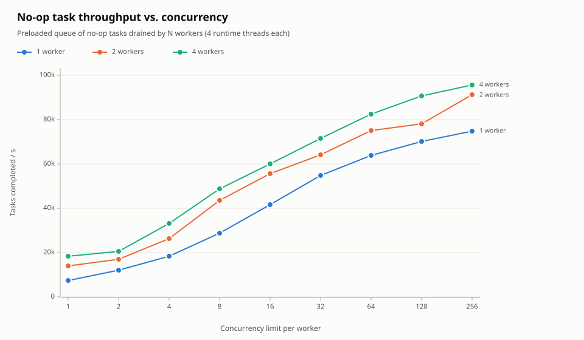
</picture>

At concurrency 1, each task needs a full cycle of round trips: claim, run, then ack. That takes about 135 µs here, which caps throughput at about 7,400 tasks/s. Higher concurrency keeps many acks and reads in flight on the multiplexed connection, and one worker reaches 64k tasks/s at concurrency 64. The extra workers help most at low concurrency, because each one adds another connection's worth of overlap. At high concurrency the curves converge at 75–95k tasks/s, which is the Redis server's limit on this machine.

### Submission throughput

<picture>
  <source media="(prefers-color-scheme: dark)" srcset="perf/graphs/submit_throughput-dark.svg">
  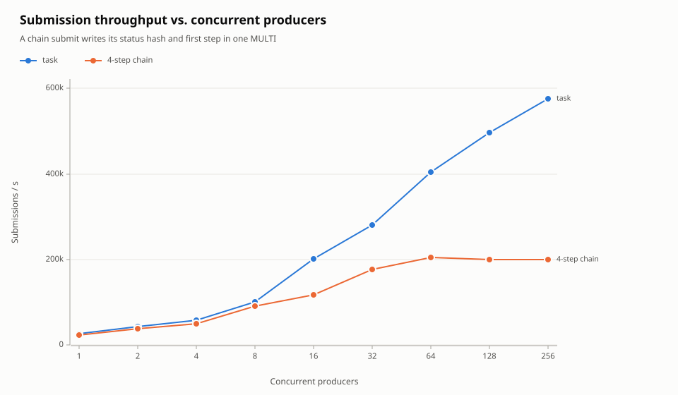
</picture>

A single producer submitting one task at a time is limited by round trips, at 28k/s. Concurrent producers sharing a `TaskQueue` are pipelined on its single multiplexed connection, and reach 575k tasks/s. Submitting a chain also writes a status record, inside a `MULTI`/`EXEC` transaction. That roughly doubles the work per submission, and chain submissions level off near 200k/s. In both cases, submitting is far cheaper than processing: a producer can enqueue faster than one worker can drain.

### Latency vs. offered load

<picture>
  <source media="(prefers-color-scheme: dark)" srcset="perf/graphs/latency_under_load-dark.svg">
  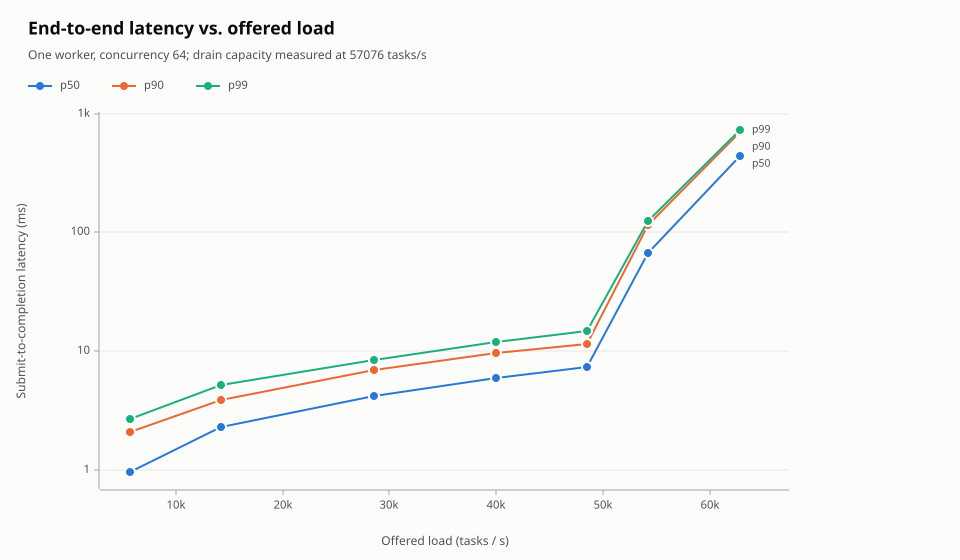
</picture>

Tasks arrived at a steady rate set as a fraction of measured drain capacity (57k tasks/s), whether or not earlier tasks had finished. Up to 49k/s (85% of capacity), p50 latency stays under 7.5 ms and p99 under 15 ms. At 54k/s (95%), the queue starts to back up and p50 jumps to 67 ms. At 110% of capacity the backlog grows for as long as the overload lasts: p50 reached 436 ms in a 4-second run. The knee comes earlier than drain capacity suggests, because submissions compete with workers for Redis. **Size for peak load at no more than about 80% of measured drain capacity.**

## 2. Chains vs. regular tasks

A chain gives you strict step ordering, an atomic hand-off of each step's output to the next step, and a status record you can query. The benchmarks compare chains against two alternatives:
- **Independent tasks:** the same number of steps, submitted at once with no ordering.
- **"DIY chain":** each processor submits the next step itself, as in the `ping_pong` example.

The DIY version has no status tracking and no atomic hand-off. A crash between the ack and the submit loses the rest of the chain. A crash after the submit but before the ack runs the next step twice.

### Throughput when Redis is the bottleneck

<picture>
  <source media="(prefers-color-scheme: dark)" srcset="perf/graphs/chain_throughput-dark.svg">
  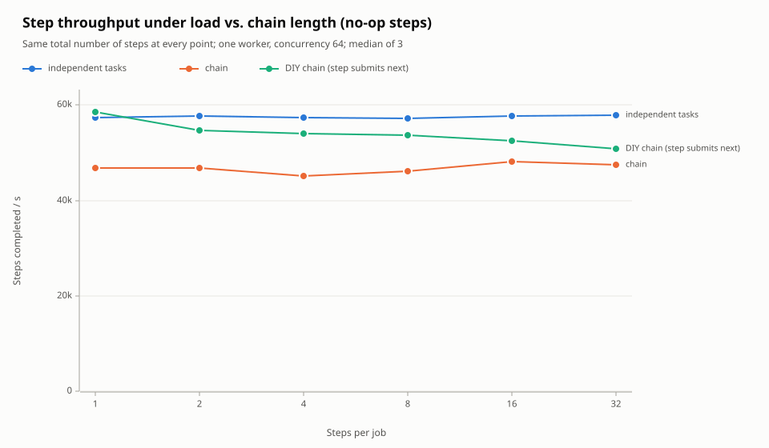
</picture>

With no-op steps, the Redis server is the bottleneck. Chains complete **45–48k steps/s against 57–58k for independent tasks, about 18% fewer**. The cause is extra work per step inside Redis: each step's script also adds the next step to its stream and updates the status record, where a plain task only acks. The cost is **flat in chain length**: a 32-step chain costs the same per step as a 1-step chain.

The DIY chain lands in between, at 51–58k. Its hand-off is two round trips (an ack script, then a separate `XADD`), but it does less work inside Redis per step. Redis time is the scarce resource here, so the DIY chain finishes more steps per second. The price is the lost atomicity and status tracking.

### Throughput when steps wait on I/O

<picture>
  <source media="(prefers-color-scheme: dark)" srcset="perf/graphs/chain_throughput_io-dark.svg">
  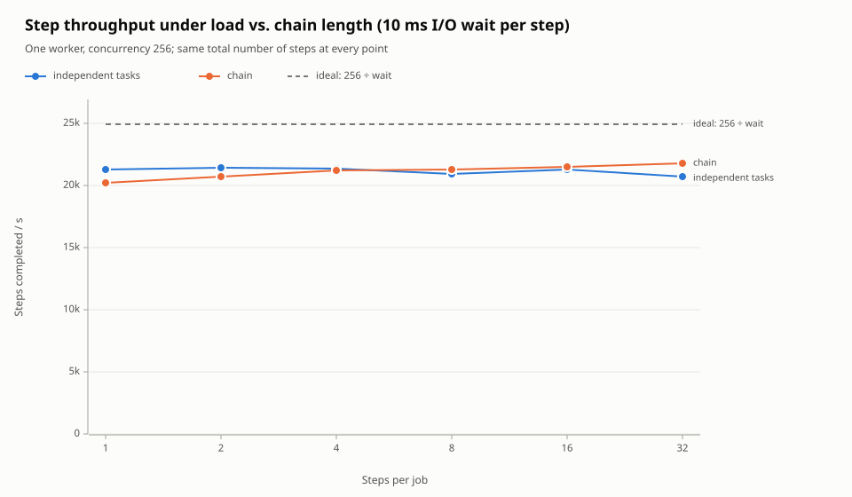
</picture>

When each step waits 10 ms, throughput is set by concurrency ÷ wait (256 ÷ 10.3 ms ≈ 25k/s). **Chains and independent tasks match: about 21k steps/s at every chain length.** A chain does make each job wait longer. Throughput holds up because other jobs' steps fill the slots while one job waits on its current step. The extra Redis work per chain step is hidden behind the I/O wait.

### Latency: sequential steps are the real cost

<picture>
  <source media="(prefers-color-scheme: dark)" srcset="perf/graphs/chain_latency-dark.svg">
  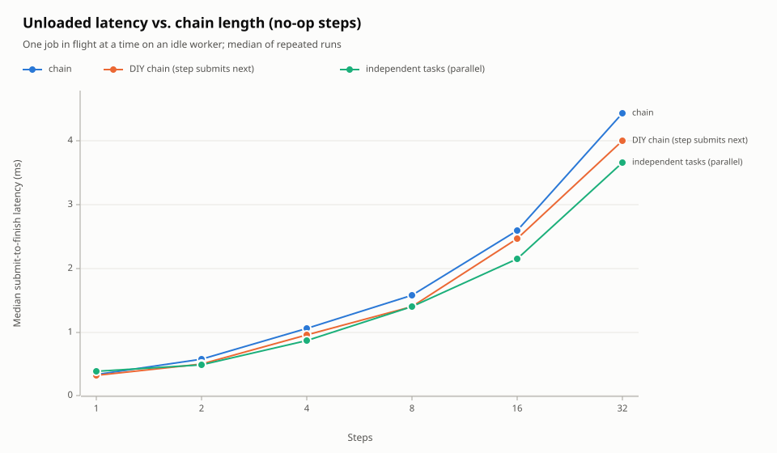
</picture>

With no-op steps on an idle worker, a chain adds about **0.14 ms per step** (4.4 ms for 32 steps). That's close to the DIY chain (4.0 ms) and even to independent tasks (3.7 ms). Without real work, nothing overlaps, and each step costs a few Redis round trips whatever the job's shape.

<picture>
  <source media="(prefers-color-scheme: dark)" srcset="perf/graphs/chain_latency_io-dark.svg">
  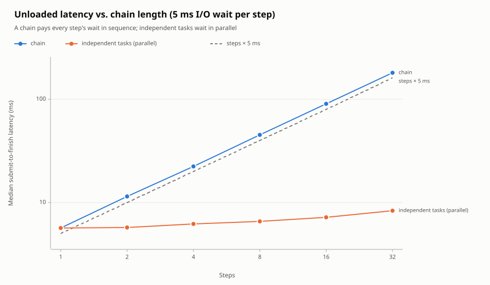
</picture>

Once steps do real work, the difference is large. A chain's latency is the **sum** of its steps: 32 × 5 ms of I/O took 180 ms, or 5.6 ms per step against 5.66 ms for a single task. Independent tasks wait in parallel, so their latency is roughly the **slowest single step** plus a little queueing: 8.4 ms for all 32. The chain's own overhead is negligible. The cost is the ordering, which is what you'd be buying a chain for.

**Use a chain** when a step truly needs the previous step's output. **Split work into independent tasks** whenever steps could run in parallel. Fan-out and fan-in (one step feeding several, or several feeding one) are the natural next feature for the graph layer.

### Context size

<picture>
  <source media="(prefers-color-scheme: dark)" srcset="perf/graphs/payload_size-dark.svg">
  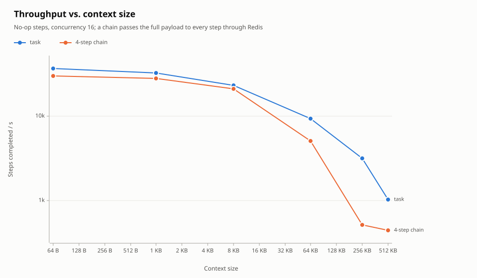
</picture>

Up to about 8 KB, context size barely matters: plain tasks fall from 39k to 27k steps/s. Above that, it costs bandwidth. Plain tasks level off at about **540–600 MB/s** of context throughput. Chains suffer more, because every hop sends its output back into Redis as a script argument, and Redis copies it into the next stream entry. A plain task's context goes in once and comes out once. From 64 KB up, chains move their payload at a **2–4× lower rate** than plain tasks. At 256 KB, chain steps ran at 554/s against 2,152/s for plain tasks.

In our runs, the 256 KB chain point was consistently slower than the 512 KB point. We don't have an explanation for that, so rely on the overall trend rather than that single point.

**For large data, pass a reference** (an object-store key or a database ID) through the chain instead of the data itself.

### Chain tradeoffs at a glance

| | Regular tasks | Chains |
|---|---|---|
| Step ordering | None | Strict |
| Latency with real work | Slowest step + queueing | Sum of all steps |
| Throughput, Redis-bound (no-op) | 57k steps/s | 47k steps/s (−18%) |
| Throughput, concurrency-bound (I/O) | 21k steps/s | 21k steps/s (no cost) |
| Cost growth with length | — | None per step |
| Passing data between steps | Your own storage | Output becomes the next input, through Redis. Cheap when small, costly from about 64 KB |
| Crash safety of the hand-off | — | Atomic: never lost, never forked |
| Progress and result | None | `chain_status`, kept for `result_ttl` |
| Extra Redis memory | — | About 170 B status record per chain, kept for `result_ttl` after it finishes |

**Watch the result TTL at high volume.** A finished chain's status record stays for `result_ttl` (24 h by default). At 10,000 chains/s, that is 864 million records, or more than 140 GB. For high-volume chains, set `.result_ttl(..)` to roughly how long callers need before they read the result.

## 3. Scaling I/O-bound tasks

Most real tasks spend their time waiting on networks, databases or other services. For those, throughput follows **Little's law: throughput = in-flight tasks ÷ time per task.**

<picture>
  <source media="(prefers-color-scheme: dark)" srcset="perf/graphs/io_bound-dark.svg">
  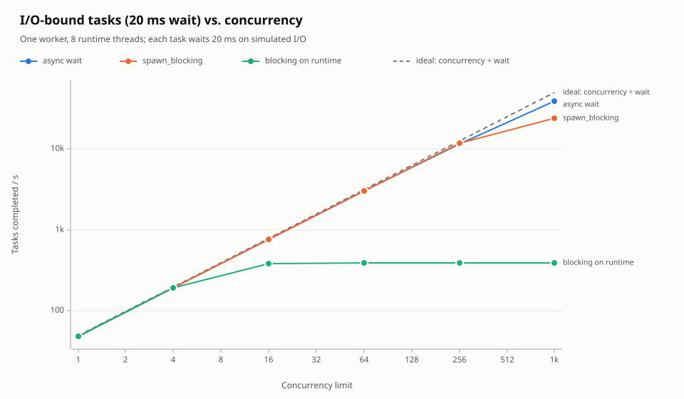
</picture>

Each task waits 20 ms, on one worker with 8 runtime threads:

- **Async waits** (any `.await` on real async I/O) follow the ideal closely: 12k tasks/s at concurrency 256 and 44k at 1,024 (88% of the ideal). A waiting task is just a parked future, so concurrency is almost free; the limits are Redis and a single worker's bookkeeping.
- **Blocking calls inside `spawn_blocking`** match the ideal until Tokio's blocking pool runs out of threads (512 by default). That caps throughput at 512 ÷ 20 ms ≈ 25k/s. Each blocked call also holds an OS thread (stack and context switches), so this approach scales to hundreds of concurrent calls, not thousands.
- **Blocking calls made directly on the runtime** (synchronous HTTP clients, `std::fs`, `thread::sleep`) cap throughput at **runtime threads ÷ wait = 8 ÷ 20 ms ≈ 391 tasks/s**, whatever the concurrency setting. They also stall the worker's own housekeeping, as section 4 shows.

### Adding workers

<picture>
  <source media="(prefers-color-scheme: dark)" srcset="perf/graphs/worker_scaling-dark.svg">
  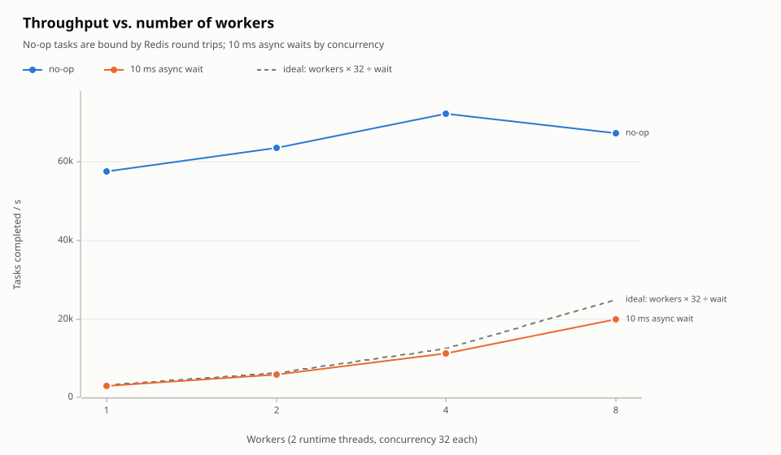
</picture>

With I/O-bound tasks, extra workers scale throughput almost linearly: 3k, 6k, 11k, then 20k tasks/s for 1, 2, 4 and 8 workers (80% of the ideal at 8). No-op tasks don't scale past about 70k tasks/s, because Redis is already the bottleneck.

**Rule of thumb:**
- Set the total concurrency limit across all workers to target throughput × average task time.
- Add workers when one process runs out of CPU or memory for its in-flight tasks, or for redundancy.
- Expect a single Redis server to cap the whole system at tens of thousands of task completions per second. Beyond that, shard by namespace across several Redis servers.

## 4. Scaling CPU-bound tasks

<picture>
  <source media="(prefers-color-scheme: dark)" srcset="perf/graphs/cpu_bound-dark.svg">
  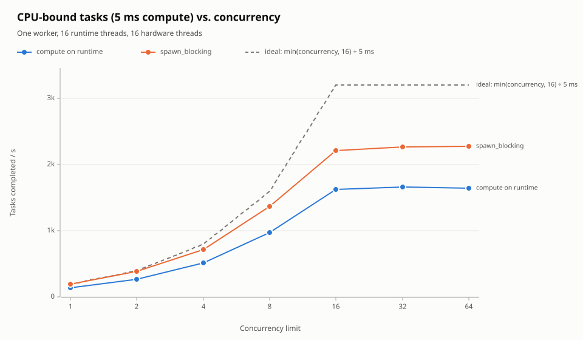
</picture>

Each task burns 5 ms of CPU, on one worker with 16 runtime threads:

- **Throughput levels off at the hardware limit.** It stops growing at concurrency 16, at about **2.2k tasks/s with `spawn_blocking`**. That's the throughput of about 11 fully independent cores. This machine has 8 physical cores with hyperthreading (2 threads per core), which gave about 1.4× over 8 cores rather than 2×. Concurrency above the core count only adds queueing.
- **Computing on the runtime is 19–25% slower at every concurrency level**, about 1.2 ms of extra wall time per task even at concurrency 1. We didn't trace the cause. The likely one is that a runtime thread busy computing can't run anything else queued on it, such as Redis connection I/O, the previous task's ack, or the fetch loop, until another thread takes that work over.

The bigger risk was correctness, not speed:

<picture>
  <source media="(prefers-color-scheme: dark)" srcset="perf/graphs/compare_lease_starvation-dark.svg">
  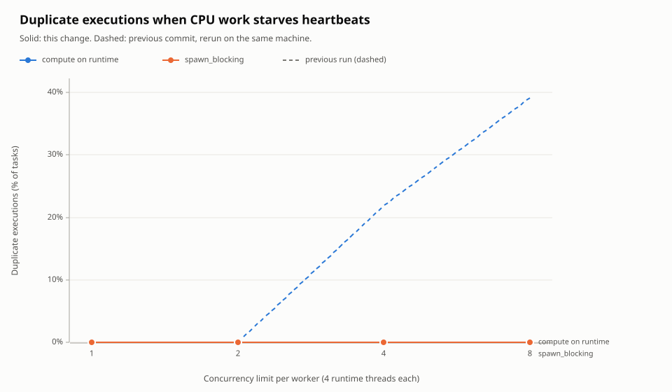
</picture>

Two workers, each with 4 runtime threads, ran 600 ms CPU tasks with a 300 ms lease. Originally, a worker renewed each lease with a heartbeat every lease ÷ 3, and that heartbeat was an async task on the same runtime as the processors. Once concurrency reached the runtime's thread count, every thread was computing and no heartbeat could run. Leases expired mid-task, the other worker reclaimed the tasks, and **22–39% of tasks ran twice** (dashed lines). The same work inside `spawn_blocking` produced no duplicates. Section 5 describes the fix: leases are now renewed from a dedicated OS thread, starting when the task is claimed. That brings duplicates to **0% at every concurrency level**, even for compute on the runtime (solid lines).

**Rules for CPU-heavy processors:**
1. **Move compute off the runtime.** Run CPU work inside `tokio::task::spawn_blocking`, or hand it to a dedicated thread pool such as rayon, and `.await` the result. Never compute for more than about a millisecond directly in the processor's async body.
2. **Match concurrency to cores.** Set the concurrency limit to about the number of physical cores for that worker. Higher limits only add latency.
3. **Keep the lease well above the longest stall in reaching Redis.** Heartbeats no longer depend on the async runtime, but they still need the monitor thread to reach Redis within two-thirds of a lease. The default 30 s lease leaves plenty of room. Short leases speed up crash recovery but leave less margin for network or Redis stalls.
4. **Give mixed workloads separate worker pools.** If one deployment serves both CPU-heavy and I/O-heavy processor types, run separate workers per class. That way CPU work can't cut into I/O concurrency, and each pool's concurrency limit can be tuned on its own.

## 5. Pushback and lease renewal

Section 4 showed that processors which block the async runtime can starve lease heartbeats, so tasks run twice. Two changes address this.

**Lease renewal on a dedicated thread.**
- **Separate from the runtime:** each worker starts a monitor OS thread with its own synchronous Redis connection. It renews every held lease every lease ÷ 3, so heartbeats never wait for a runtime thread.
- **Covers the whole task:** a lease is registered when the task is claimed and released after its outcome is recorded. That covers time spent queued, waiting for a permit, running and acking. The first version registered the lease only when the task started running. That still let one task run twice when the run queue was deeper than a lease, which the A/B test caught.

**Pushback (adaptive concurrency).** The same monitor thread measures *scheduling lag*: how long ready work waits for a runtime thread. It uses whichever of two measurements is worse:
- **A probe:** a tiny task sent into the runtime every 10 ms.
- **Admitted tasks:** the time each claimed task waits between being dispatched and first running. This catches backlog that the probe misses, because Tokio serves injected tasks ahead of a backed-up local run queue.

The concurrency limit then follows TCP-style congestion control:
- **Slow start:** start at the runtime's thread count, and double while the runtime keeps up and demand exceeds the limit.
- **Decrease:** cut by 30% when lag exceeds the budget, once in-flight work has drained down to the current limit.
- **Recovery:** after the first cut, grow by 1 per sample.

While the limit is lowered, the worker claims less, and the backlog stays in Redis for other workers. Settings: `max_scheduling_lag` (default lease ÷ 10, clamped to 5–100 ms), `min_concurrency`, and `adaptive_concurrency(false)` to turn pushback off. `WorkerHandle::stats()` exposes the live limit, tasks in flight and lag.

<picture>
  <source media="(prefers-color-scheme: dark)" srcset="perf/graphs/pushback_limit-dark.svg">
  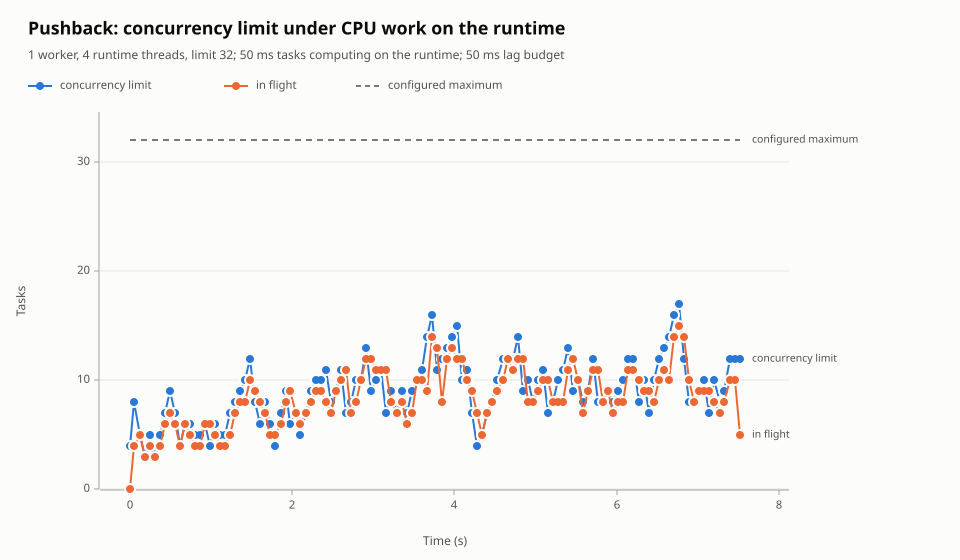
</picture>

<picture>
  <source media="(prefers-color-scheme: dark)" srcset="perf/graphs/pushback_lag-dark.svg">
  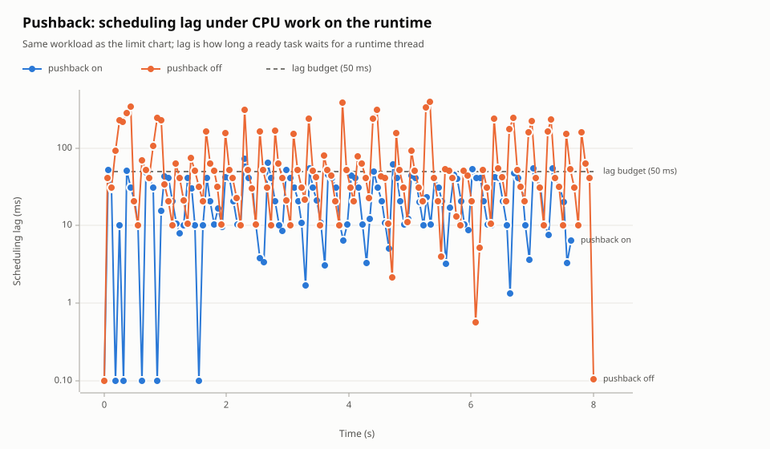
</picture>

The workload is one worker with 4 runtime threads, running 50 ms tasks that compute directly on the runtime (the case section 4 warns against). Pushback holds the limit at 8–12 instead of 32:

| | p50 lag | p99 lag | Throughput |
|---|---:|---:|---:|
| Pushback off | 41.6 ms | 390 ms | 50 tasks/s |
| Pushback on | 20.6 ms | 64 ms | 52 tasks/s |

Throughput doesn't suffer, because 4 threads can't run more than 4 compute-bound tasks at once anyway. The extra admitted tasks only queued, and held their leases while they did.

### No regressions elsewhere

The full before/after report is [`perf/comparison.md`](perf/comparison.md), with overlay charts for every scenario. Getting a trustworthy comparison took two attempts:
- **First attempt: back to back.** Running the whole previous commit, then the whole new code, flagged 10–35% "regressions". That included submission throughput, which doesn't touch the changed code. Re-running the *previous* commit then showed the machine itself had slowed by 30–45% between the runs.
- **Second attempt: interleaved.** [`perf/ab.sh`](perf/ab.sh) runs each scenario on both checkouts in A B B A order (`ROUNDS=n` repeats the cycle), so drift hits both sides equally. It then compares the medians, flagging only changes larger than twice the baseline's own run-to-run noise (and at least 10%).

On the interleaved comparison:

| Scenario | Median change | Flagged |
|---|---:|---|
| No-op throughput vs. concurrency | −1.5% | none (one improvement) |
| Submission throughput (control) | +1.2% | none |
| Latency vs. offered load | +4.2% | 5 improvements (p99 near capacity 19–26% lower) |
| Unloaded chain latency | +5.1% | 4 improvements |
| Chain step throughput | −3.3% | none |
| I/O-bound and CPU-bound scaling | −0.4% / −3.1% | none |
| Duplicate executions | — | 2 improvements (22% and 39% → 0%) |

The first controller *did* cost 10–30% of no-op throughput. Re-running with pushback off traced that to the controller rather than per-task overhead. The cause was its test for saturation, a 10 ms sample of tasks in flight. With cheap tasks, permits are released and re-taken between samples, so the limit rarely grew. It now grows when a fetch actually wanted more permits than were available.

## Tuning summary

| Situation | Setting |
|---|---|
| No-op or very short tasks | Concurrency 64–256 per worker; Redis is the limit |
| I/O-bound tasks | Concurrency ≈ target throughput × task time, spread across workers |
| CPU-bound tasks | `spawn_blocking`; concurrency ≈ physical cores per worker. Pushback limits the damage if something blocks anyway |
| Latency-sensitive | Keep peak load below about 80% of measured drain capacity |
| Chains | Use only for real data dependencies; pass references, not large payloads; set `result_ttl` for high volume |
| Short leases | Safe from runtime starvation now; keep them well above the longest Redis or network stall |
| Comparing performance | Use `perf/ab.sh` (interleaved) rather than comparing separate runs |
